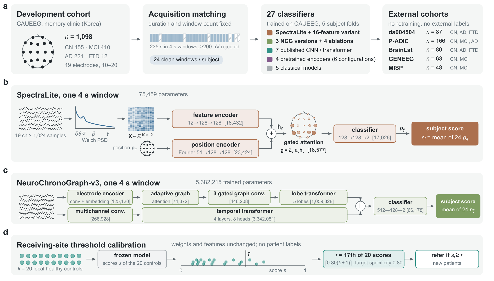

# NeuroChronoGraph and SpectraLite

**Transferring EEG dementia classifiers and their referral thresholds between independent clinical cohorts**

[](https://python.org)
[](https://pytorch.org)
[](LICENSE)
[](#data)

Code to reproduce every analysis in

> S. Ghosh, R. N. Chaurasia, S. Sharma, and N. Sharma, "Transferring EEG Dementia Classifiers and Their
> Referral Thresholds Between Independent Clinical Cohorts," manuscript submitted to *IEEE Journal of
> Biomedical and Health Informatics*, 2026.

We designed two model families for resting-state EEG dementia screening and tested them among 27 classifiers
on cohorts they were never trained or tuned on:

- **SpectraLite**: a 75,459-parameter network that reads 12 named spectral markers per electrode
  (relative band powers, alpha peak frequency, aperiodic exponent, slowing ratios, spectral entropy) from
  any subset of 10–20 electrodes and pools them with gated attention.
- **NeuroChronoGraph (NCG)**: graph–temporal networks of up to 5.4 M trained parameters. NCG-v3, the best version
  in development, learns electrode nodes from the raw signal through a learned graph, gated graph
  convolutions, and a lobe transformer, fused with a temporal transformer.



*(a) 27 classifiers trained on CAUEEG and applied unchanged to five external cohorts. (b) SpectraLite and
(c) NeuroChronoGraph-v3 for one 4 s window, with per-block parameter counts. (d) A receiving clinic sets
its referral threshold from 20 of its own healthy recordings, without patient labels.*

## Main findings

Control versus dementia AUC (three-seed ensembles; internal values out-of-fold):

| Model | Trained parameters | CAUEEG (internal) | ds004504 | P-ADIC | BrainLat |
|---|---:|---:|---:|---:|---:|
| SpectraLite | 75 k | 0.856 | 0.846 | 0.684 | 0.613 |
| NCG-v3 | 5.4 M | **0.906** | **0.863** | **0.717** | 0.603 |
| NCG-v5 | 915 k | 0.874 | 0.822 | 0.676 | 0.609 |
| Random forest, 123 QEEG features | – | 0.810 | 0.840 | 0.705 | 0.588 |
| Median of 22 models | – | 0.841 | 0.840 | 0.682 | 0.621 |

1. **Capacity helped only in development.** NCG-v3 beat SpectraLite internally by 0.049 AUC (95% CI
   0.032–0.067, Holm *P* < 0.001) but by only −0.010 to +0.033 externally; no external paired comparison
   survived Holm correction.
2. **The cohort mattered more than the model.** For control versus Alzheimer's disease, the endpoint defined
   alike at the three external dementia cohorts, the cohort explained 88% of the variance in AUC across 26 models
   and the model 5% (89% and 4% for dementia, which counts FTD at two of the three). Healthy recordings alone identified their
   cohort (AUC 0.96–1.00). Severity, age, and education explained part of the gap: mild Alzheimer's disease
   was detected at AUC 0.52 at one cohort, moderate at 0.88. Changing the preprocessing or the recording
   condition in the same 69 subjects moved the median AUC by less than 0.02.
3. **Thresholds did not transfer; local calibration fixed specificity but not sensitivity.** The development
   threshold gave specificity 0.33–0.68 at the external cohorts. A split-conformal threshold from 20 local
   healthy controls gave mean specificity 0.79–0.82 within cohorts (0.68 across recording conditions), with
   sensitivity 0.32–0.70.
4. **The markers explain the referrals.** With predictions fixed before the analysis
   ([`prespecified/PREDICTIONS_264_MARKERS_2026-10-23.md`](prespecified/PREDICTIONS_264_MARKERS_2026-10-23.md)),
   7 of 11 held: Alzheimer's disease shifted the same spectral markers at every cohort (pooled theta/alpha
   Hedges g 0.98), healthy baselines differed between cohorts, and falsely referred controls lay further
   along a development-fitted marker axis (AUC 0.85).
5. **Mild cognitive impairment was not detected externally** (SpectraLite AUC 0.46–0.60 at three cohorts).

The models are research artifacts. Sensitivity was too low to rule out dementia, and local calibration
needs prospective testing before any clinical use.

## Weights

Trained weights for both families (all tasks, three seeds, five folds; safetensors with model cards and
checksums) are on Hugging Face:

- [huggingface.co/soinikghosh9/SpectraLite](https://huggingface.co/soinikghosh9/SpectraLite)
- [huggingface.co/soinikghosh9/NeuroChronoGraph](https://huggingface.co/soinikghosh9/NeuroChronoGraph)

The weights are licensed CC BY-NC 4.0: they were trained on CAUEEG, whose terms allow academic and research
use only.

## Quick start

```bash
pip install -r requirements.txt
```

```python
import torch
from safetensors.torch import load_file
from src.models.spectral75k import SpectraLite, conformal_threshold

model = SpectraLite(n_features=12)
model.load_state_dict(load_file("spectralite/CN_vs_dementia/seed42/fold0.safetensors"))  # from Hugging Face
model.eval()

# x: one subject's 24 preprocessed 4 s windows, (24, 19, 1024) at 256 Hz, each window and channel centred on
# its median and divided by its interquartile range. Electrodes in the order
# Fp1 Fp2 F3 F4 C3 C4 P3 P4 O1 O2 F7 F8 T3 T4 T5 T6 Fz Cz Pz
with torch.no_grad():
    subject_score = model(x=x).softmax(-1)[:, 1].mean().item()

# At a new clinic: threshold from k local healthy controls' scores (no patient labels).
tau = conformal_threshold(local_control_scores, target_specificity=0.80)
refer = subject_score > tau
```

The paper scores each external subject with the mean over the five fold models of each seed and then over
the three seeds.

## Reproducing the paper

Set `ALZ_ROOT` to the folder that holds `datasets/` (the cohorts below) and receives the cleaned-recording cache
and checkpoints; results are written to `outputs/`.

| Step | Script |
|---|---|
| Fetch raw ds004504 | `experiments/124_fetch_raw_ds004504.py` |
| Harmonised cleaning of every cohort (filter, reference, ICA with ICLabel) | `experiments/126_harmonise_corpus.py` |
| Duration matching, windowing, rejection, 24 windows per subject | `experiments/127_extract_harmonised.py` |
| P-ADIC, BrainLat, MISP extraction | `experiments/224_padic_site.py`, `232_brainlat_site.py`, `263_misp_external.py` |
| All networks, internal and external scores, checkpoints | `experiments/211_canonical_benchmark.py` |
| Classical baselines (random forests, gradient boosting, SVM, logistic regression) | `experiments/212_classical_benchmark.py` |
| Pretrained encoders (LaBraM, EEGPT, CBraMod, LEAD) | `experiments/216_fm_matched.py`, `252_fm_external_complete.py` |
| 16-feature variant | `experiments/237_canonical_spectralite16.py` |
| Paired tests, equivalence, Holm correction | `experiments/225_merge_stats.py` |
| Cohort identity from healthy controls (paper Fig. 2b) | `experiments/229_site_shift.py` |
| Cohort-versus-model variance decomposition, severity (paper Fig. 3a) | `experiments/257_review_revision.py` |
| Learning curves, recipe sensitivity | `experiments/214_learning_curve.py`, `213_tuning_fairness.py` |
| Age and education | `experiments/248_age_confound_all_sites.py` |
| Recording condition and preprocessing (paper Fig. 3b,c) | `experiments/260_protocol_shift.py`, `260b_protocol_thresholds_ncg.py`, `261_protocol_matched_training.py` |
| Threshold calibration, clinical metrics, net benefit (paper Fig. 4) | `experiments/221_local_calibration.py`, `250_clinical_metrics.py`, `255_age_adjusted_and_net_benefit.py` |
| Prespecified transfer methods | `experiments/249_spectralite_transfer_levers.py`, `251_improvement_summary.py` |
| MISP (analyzed last, predicted in advance) | `experiments/263_misp_external.py` |
| Marker validation (paper Fig. 5; predictions in `prespecified/`) | `experiments/264_marker_validation.py` |
| Residual artifact burden (supplementary Table S17) | `experiments/265_artifact_sensitivity.py` |
| Parameter counts (trained and declared) | `experiments/227_param_budget.py` |
| Hugging Face export | `experiments/241_export_hf_release.py` |

Every script documents its inputs and outputs at the top. LaBraM, EEGPT, and CBraMod load through braindecode
from the Hugging Face Hub; LEAD needs its own repository and pretraining checkpoint under
`$ALZ_ROOT/third_party/` (see `experiments/216_fm_matched.py`).

## Data

All cohorts are public and were used under their terms; none is redistributed here.

| Cohort | Role | Source |
|---|---|---|
| CAUEEG | development (1,098 subjects) | Kim et al., *NeuroImage* 272:120054 (2023); access by application to its authors |
| ds004504 | external | [OpenNeuro ds004504](https://openneuro.org/datasets/ds004504) |
| ds006036 | same subjects, photic session | [OpenNeuro ds006036](https://openneuro.org/datasets/ds006036) |
| P-ADIC | external | Shor et al., *PLOS ONE* 16:e0255529 (2021) |
| BrainLat | external | Prado et al., *Scientific Data* 10:889 (2023) |
| GENEEG | external | Mishra et al., arXiv:2501.17871 (2025) |
| MISP | external | Kashefpoor et al., *J. Med. Signals Sens.* 6:25 (2016) |

## Earlier versions of this repository

Until October 2026 this repository described a hierarchical four-class NeuroChronoGraph evaluated within
CAUEEG and ds004504 (about 82% accuracy). Later audits found recording-duration and cohort confounds in that
protocol; the results above, on duration-matched data with five external cohorts, supersede it, and its code
was removed from this branch. It remains in the git history.

## License and citation

Code: MIT License (see [LICENSE](LICENSE)). Weights: CC BY-NC 4.0, under CAUEEG's academic-and-research-only
terms. If you use the code or weights, please cite the paper above and the CAUEEG dataset (Kim et al., 2023).
